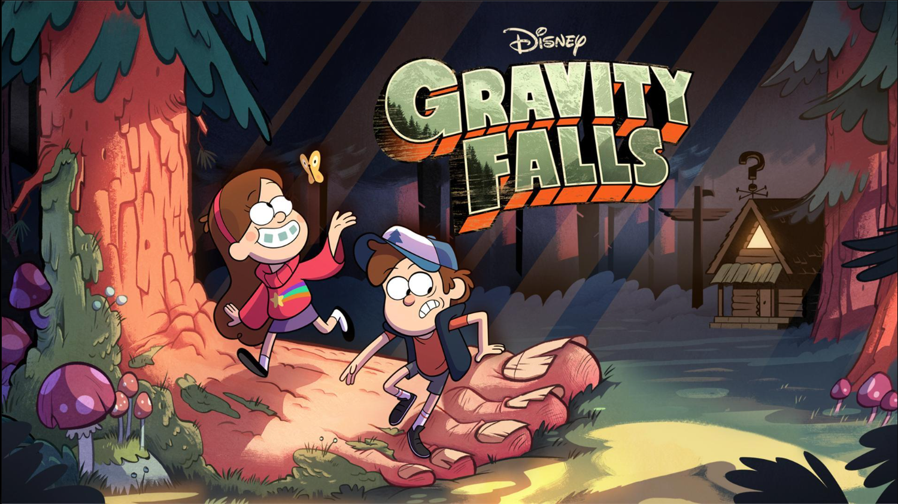

# app-dev
My first repository

---

## 🌲 Gravity Falls

> "Trust no one."

**Gravity Falls** is an animated mystery-comedy television series created by **Alex Hirsch**. It follows twins Dipper and Mabel Pines as they spend their summer vacation with their Great-Uncle Stan in a mysterious town called Gravity Falls, Oregon.

The twins discover supernatural creatures, strange mysteries, and secrets hidden throughout the town.

## 🔗 Key Information

- **Genre:** Mystery, Adventure, Comedy, Fantasy
- **Seasons:** 2
- **Episodes:** 40
- **Creator:** Alex Hirsch
- **Original Network:** Disney Channel

## 👥 Main Characters

1. **Dipper Pines** – A curious and intelligent boy who loves solving mysteries. He discovers a mysterious journal that helps him investigate the supernatural events in Gravity Falls.

2. **Mabel Pines** – Dipper's energetic and cheerful twin sister. She loves crafting, colorful sweaters, and having fun while exploring the mysteries of the town.

3. **Grunkle Stan** – The twins' great-uncle and owner of the Mystery Shack. He is greedy, funny, and always looking for ways to earn money from tourists.

4. **Soos Ramirez** – A friendly and loyal handyman who works at the Mystery Shack. He often helps Dipper and Mabel during their adventures.

5. **Wendy Corduroy** – A cool and laid-back teenager who works at the Mystery Shack. She becomes a close friend of the twins.

## ⚔️ Villains

1. **Bill Cipher** – A powerful and mysterious dream demon who wants to enter the real world and bring chaos to the universe. He uses manipulation, tricks, and supernatural powers to achieve his goals.

2. **Gideon Gleeful** – A young character who appears friendly and innocent but is actually manipulative and selfish. He wants to take control of the Mystery Shack and defeat Grunkle Stan.

## 📊 Quick Overview

| Category | Rating/Details |
|---|---|
| Animation | Colorful and expressive animation |
| Storyline | Mystery, adventure, and unexpected twists |
| Soundtrack | Memorable and mysterious music |
| My Score | 10 / 10 |

## 🌐 Visit My Portfolio

[Visit My GitHub Profile](https://github.com/Gabby-chan)

---

*Created as part of my Application Development activity.*
